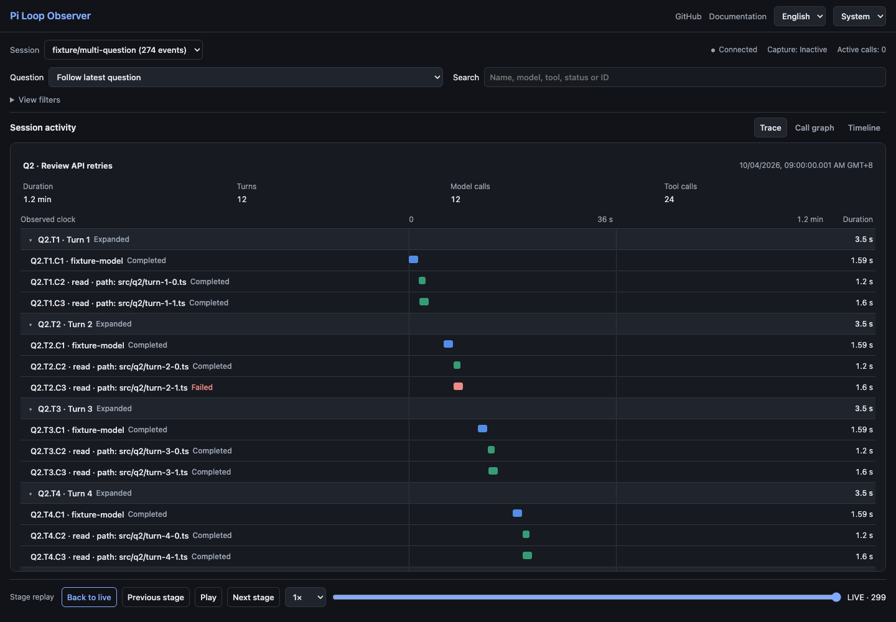

# Pi Loop Observer

[中文文档](README.zh-CN.md) · [Design and implementation](docs/implementation/README.md) · [Usability improvement plan](docs/implementation/usability-improvements.md)

A local, persistent visual observer for Pi agent loops. Record automatically while the browser is closed; inspect questions, turns, model responses and tool calls later, even after Pi has exited.

## Start

Requires Node.js >= 22.19.0 and pnpm. Tested with Node 24.18.1 and Pi 1.3.0.

```sh
pnpm install
pnpm build
```

Load the extension from the workspace you want to observe:

```sh
pi -e /absolute/path/to/pi-loop-observer/dist/adapter/index.js
```

Recording starts on `session_start`. Run **`/obs`** in Pi to open the browser. `/obs` opens the viewer; it does not turn recording on.

After exiting Pi, open history from this project:

```sh
pnpm open
# Or:
node dist/cli/main.js open
```

Use `open --no-open` to print a one-time viewer URL. Records live in `~/.pi/loop-observer/`; set `PI_LOOP_OBSERVER_DIR` or use CLI `--data-dir` for a different directory. Pi and the viewer must use the same directory. The independent service exits after producer/viewer leases and the idle grace period expire; SQLite records remain.

Pi package installations do not necessarily put the standalone command on your shell PATH. The explicit Node entry point above always works from a built project. No personal Pi configuration is changed automatically.

## Explore a session

- **Trace workspace:** the default view combines compact hierarchical rows and a per-question waterfall, with duration and call-count summaries. Follow the latest question automatically, pin an earlier question, or view all questions. Click a question, turn or call for details; search highlights and scrolls to its result.
- **Grouped call graph:** each question is a container, each turn is a row, and its model/tool calls run left to right. Recorded call and result-consumption arrows retain direction, with cross-turn edges routed around cards. Collapse a question or turn, pan, fit the graph, or focus a call. Spatial membership does not imply execution dependencies.
- **Distinct names:** stable identifiers such as `Q2.T3.C1`, prompt excerpts, model names and tool input summaries distinguish repeated calls. Filtering preserves numbering.
- **Per-question timelines:** every question has its own zero point and scale, with turn and call durations. A session overview retains the total span, including gaps between questions. Concurrent calls remain overlapping.
- **Pi 1.3.0 timing:** tools use the SDK execution duration when supplied, while waterfall positions retain observed start/end times. Explicit cancellation is recorded; older events remain readable without a database migration.
- **Readable times:** durations automatically use ms, s, min or h. Details include absolute timestamps and the local timezone. Unknown historical timing stays unknown.
- **Search and navigate:** search visible question summaries, call labels, IDs, tools, models, statuses and available input summaries. Search is restricted to the selected replay prefix; it is not a full-text archive search.
- **Focused workspace:** Trace, call graph and timeline share one main area. Details open on demand, beside Trace on desktop and below it on mobile. Question selection and search stay visible; branch, turn and call navigation live in collapsible filters. Trace rows are 34px on desktop and 40px on mobile; graph nodes remain 90px tall.
- **Color themes:** System is the default and follows operating-system changes. Explicit Dark, Light or System choices are remembered and apply to charts and controls. Existing saved preferences are respected.
- **English by default:** switch to Chinese in the header. The browser remembers your choice; original prompts and outputs are not translated.
- **Read-only replay:** pause, step through phases, play and return to live. New records continue arriving while the visible replay is paused.

## Import existing Pi history

```sh
node dist/cli/main.js import /absolute/path/to/session.jsonl
```

The importer supports native Pi v3 JSONL. Archived content remains readable after the source file is removed. Imported histories contain content and branches, but do not gain timing or phases that were never recorded. Invalid lines, incomplete tails and archive gaps are reported.

## Development and verification

```sh
pnpm typecheck
pnpm test
pnpm test:compat
pnpm test:e2e
pnpm test:pack
```

Tests use temporary directories, synthetic events and a fake model stream. The Pi SDK, SQLite, HTTP/SSE, detached processes and browser run for real. No personal sessions, credentials or paid model requests are used. Browser tests require local Chrome. Test scripts build their required artifacts first.

After editing source, run `pnpm build` and refresh the same-origin viewer. A separate-port authenticated Vite HMR proxy is not included yet. If the npm registry is inaccessible, set a registry for one installation command, for example `pnpm install --registry=https://registry.npmmirror.com`. Native SQLite installation may require platform build tools.

See [acceptance evidence](docs/implementation/acceptance.md), [Pi compatibility](docs/implementation/compatibility.md), and [runtime notes](docs/implementation/runtime-notes.md).

## Boundaries

- Tested with Pi 1.3.0 on macOS arm64 and Node 24.18.1. The host peer range `*` is a Pi package-resolution convention, not a compatibility promise for every version.
- Pi does not expose a reliable consumed-input ID. Submitted steer/followUp intent is recorded, but ambiguous applied-input associations stay unclassified.
- An LLM node represents an observed assistant message, not an exact HTTP attempt. Internal result assembly, provider retries and TTFT are not inferred.
- Replay advances through observable phases, not individual tokens or original wall-clock pacing. Different monotonic clock domains are kept separate.
- Streaming content preview, large-payload staging uploads and log rotation are not implemented. A captured payload is capped at 512 KiB and explicitly marked when truncated. Large initial sessions may exceed the bounded queue.
- A sudden process exit can lose the unacknowledged in-memory tail. Producer loss is marked as an observation gap, not as proof of tool failure.

## Source map

| Directory                     | Responsibility                                                      |
| ----------------------------- | ------------------------------------------------------------------- |
| `src/model`                   | Shared facts, pure reducer, projection and prefix replay            |
| `src/adapter`, `src/capture`  | Pi hooks, phase capture, bounded queue and immutable payloads       |
| `src/importer`                | Native entries, JSONL archives and explicit source binding          |
| `src/recorder`                | SQLite transactions, payload paging and rebuildable indexes         |
| `src/server`, `src/lifecycle` | Local HTTP/SSE, authentication, detached service and leases         |
| `src/cli`                     | History viewer and explicit file import                             |
| `web/src`                     | Display names, timing, localization, navigation, graph and details  |
| `test`                        | Model, capture, storage, process, SDK, packaging and browser checks |

## Running UI



[Mobile view](docs/implementation/screenshots/v6-mobile-320-trace-dark.png) · [v0.2 verification](docs/implementation/usability-improvements.md)

## Design prototypes

`design/` contains the earlier synthetic interaction prototype and architecture diagrams. It is separate from the running observer. Use `pnpm preview` to inspect it. [Architecture](design/architecture.html) · [Research](docs/research.md) · [Reference implementation notes](docs/provider-trace-reference.md)

Replay follows recorded time: 1× preserves elapsed time, with 0.5×/2× speed, pause/resume, and time seeking. Stage buttons remain available. Cross-clock timing is explicitly marked approximate.
