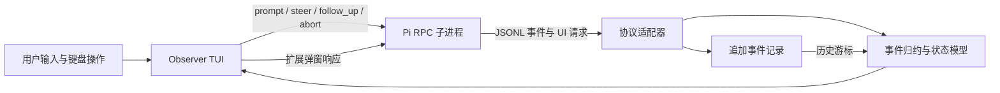

# CLI 可视化：支持范围与路线建议

核对日期：2026-10-03。状态：源码与公开接口核对完成；尚未实现终端原型或完成真实模型端到端验证。用户已决定暂不实施 CLI 方案，继续原本的浏览器只读观察器路线；以下方案仅作为调研备查。

## 结论

终端可以实现实时节点图、状态动画、并行调用时间条、节点详情和阶段回放。它需要针对字符网格、终端尺寸与键盘交互重新设计，不能原样搬入浏览器画布。

Pi 官方扩展能够重绘工具行、添加状态组件和覆盖层，但没有公开的整段原生对话区替换接口。若要求模型、工具、结果都由统一执行图接管，建议独立 TUI 客户端通过官方 RPC 驱动 Pi；若必须安装为原生 Pi 扩展，则需接受局部替换或覆盖层的限制，或另行为上游增加渲染接口。

## 核对基线

- 本机安装包 `@earendil-works/pi-coding-agent` 为 **1.0.0**；核对其 `dist/core/extensions/types.d.ts` 与 `dist/modes/interactive/interactive-mode.js`。
- 上游固定提交 **a276dabe57911253350bffb93cb7d7aff6a73261**，提交时间 2026-10-02 22:14:52 UTC，包版本同为 1.0.0。
- 本机安装包和该提交的整体内容不声明完全相同；这里只确认涉及本结论的接口与调用路径一致。
- 旧浏览器方案引用的 0.85.1 源码基线保留。实现前需统一支持版本，不能混用两个版本的事件契约。

## 支持矩阵

| 目标 | 官方支持与限制 |
| --- | --- |
| 实时状态、耗时、字符图形 | `setWidget()` 接收自定义 Component；可用 `tui.requestRender()` 更新，原生 working 行可通过 `setWorkingVisible(false)` 隐藏。 |
| 工具调用、执行中结果、最终结果 | ToolDefinition 的 `renderCall`、`renderResult`、`renderShell: "self"` 支持定制。覆盖内置工具通常需要注册同名工具并正确委托原执行逻辑；不是全局工具显示开关，第三方工具需逐一适配。 |
| 模型正文与 thinking 的显示 | `registerMarkdownTransformer` 可以按 assistant / assistant-thinking 转换显示文本；返回的仍是 Markdown 字符串，不是任意组件。隐藏 thinking 的占位文字、错误提示和部分间距由原组件单独管理。 |
| 用 registerMessageRenderer 替换 assistant | 不支持。该 API 接收 CustomMessage，而非普通 assistant 消息；registerEntryRenderer 也只处理自定义条目。 |
| 用 custom() 接管原生对话区 | 不支持直接接管。无 overlay 时源码将组件放入 editorContainer；overlay 模式覆盖已有内容，底层对话组件仍然存在。可以做实时查看器，不能视为原生输出已被替换。 |
| 完全自有终端界面 | SDK / RPC 支持。前端订阅事件并自行渲染，不实例化 Pi 原生 interactive transcript。 |

不要为了隐藏显示而在 `message_end` 中删改实际消息；这会改变消息数据，不能当作纯展示层操作。也不建议修改 Pi 私有组件、抢写 ANSI 或清空内部容器作为稳定扩展接口。

## 建议路线：独立 TUI + 官方 RPC



建议命令形态：`pi-loop-observer` 启动自有界面，后台启动 `pi --mode rpc`。这是建议的将来命令，目前项目没有该可执行程序。

RPC 保留 Pi 负责模型、工具、会话、重试与上下文管理。前端负责输入编辑、状态图、详情、快捷键和交互弹窗。使用进程边界方便复用已安装 Pi；若后续决定同进程 TypeScript 集成，官方 SDK 的 `createAgentSession()` 与 `session.subscribe()` 也可驱动同一视图模型，但要自行绑定扩展 UI。

重要兼容边界：

- RPC 支持 select / confirm / input / editor 的请求响应；客户端必须实现这些对话，不能忽略确认请求或默认同意。
- RPC 不传输扩展的自定义 Component，`custom()` 不可用，header/footer/editor factory 等是 no-op；不能承诺所有现有 TUI 扩展无缝兼容。
- RPC `prompt` 成功只表示接受或排队，不表示执行完成；需要持续处理 session events。
- 不能把前端实现等同于重建 Pi 的全部 CLI 功能。MVP 先覆盖输入、取消、steer/follow-up、调用详情和弹窗；会话树、主题、补全等按范围单独验收。
- UI 图形使用官方 pi-tui 或另一个单独选择的 TUI 库。只有自有进程启动终端渲染器；若走扩展路线，必须使用 Pi 注入的渲染器。

## 终端交互草案

宽终端左右分栏，左侧执行图，右侧选中节点详情；底部独立时间轴和输入区。以下仅示意字符布局，非运行截图。

```text
 Pi Loop Observer    ● LIVE     问题 03    12.4 s
 ──────────────────────────────────────────────────
 ✓ 输入               │ LLM #2 · 输出中
 │                    │ 已运行 2.0 s
 ✓ LLM #1   4.2 s     │ 输入 / 输出 / 事件
 ├─ ✓ read  1.8 s     │ …按需展开正文…
 └─ ! bash  6.2 s     │
 │                    │
 ◉ LLM #2   2.0 s     │
 ──────────────────────────────────────────────────
 LLM  ████      ██▶
 read     ██
 bash     ██████
      0   4     10 12.4 s       [跟随实时]
 ──────────────────────────────────────────────────
 > 输入问题…
 Tab 切换区域 · ↑↓ 选择 · Enter 详情 · Esc 返回
```

实际时间轴必须用统一时间映射，图中连接表示调用关系；不要把字符示意的长度当成测量比例。失败工具用独立错误状态，不把整次问题自动标为失败。

- 运行节点小范围动画，完成节点静止；信息必须通过文字或符号表达，不能只依赖颜色。
- 已完成轮次折叠成摘要，当前轮展开；节点稳定定位，避免每个 delta 引发整个图跳动。
- 详情与输入分别管理焦点；查看历史时实时采集继续，但不抢视口。明显标识“历史回放”和“返回实时”。
- 窄终端改为单栏：执行图 / 详情切换；更窄时退化为树形列表。所有操作提供键盘路径，鼠标仅增强。
- 阶段回放只消费记录，不再次执行模型或工具；沿用浏览器方案的归约器和记录格式。
- 流式增量可合并渲染，关键开始/完成事件保留；帧率限制是设计参数，性能需实测。

## 状态名称必须对应证据

- 模型调用活动、thinking 输出、文本输出、工具参数生成、工具执行是不同事件阶段。
- `toolcall_delta` 表示模型生成工具参数；`tool_execution_start` 才表示开始执行工具。
- 模型输出文本时不能提前称为“最终回答”，后续仍可能继续调用工具。
- 没有独立事件证明的“结果组装”不显示为已测量的 Pi 内部阶段；如指 Observer 自己整理视图，应明确归属前端。
- `turn_start` 不是网络请求起点的精确替代。精确模型请求耗时需另核对调用边界，不能把整个 turn（含工具执行）算作纯 LLM 耗时。
- `agent_settled` 比 `agent_end` 更适合判断自动工作已经停止；每个问题的边界仍需处理 steer/follow-up。

## 下一步验证及待决策

当前决策：暂不实施 CLI，无需继续选择终端入口。以下验证仅在未来重新启动 CLI 方向时考虑。

若接受独立命令，建议先以可控事件和假模型验证：两轮 LLM、并行工具、部分结果、错误、取消、扩展确认弹窗、窄屏、resize、回放与实时一致性，再接真实模型。此时无需先建设 SSE/浏览器服务；原网页效果稿作为可选展示端保留。

若必须保留原生 `pi`，先制作 widget + 工具 renderer + overlay 验证稿，明确接受哪些原生正文继续显示。若要求对话区完全替换，则需要额外的上游 transcript renderer 接口或维护补丁，这不属于当前公开扩展 API 已具备的能力。

## 官方依据

- [扩展类型定义](https://github.com/earendil-works/pi/blob/a276dabe57911253350bffb93cb7d7aff6a73261/packages/coding-agent/src/core/extensions/types.ts#L145)：UI、工具 renderer、MarkdownTransformer、CustomMessage renderer 的公开契约。
- [AssistantMessageComponent](https://github.com/earendil-works/pi/blob/a276dabe57911253350bffb93cb7d7aff6a73261/packages/coding-agent/src/modes/interactive/components/assistant-message.ts#L109)：普通模型输出、thinking 和错误提示的原生渲染。
- [实时 assistant 组件创建](https://github.com/earendil-works/pi/blob/a276dabe57911253350bffb93cb7d7aff6a73261/packages/coding-agent/src/modes/interactive/interactive-mode.ts#L3453)：直接实例化原生组件。
- [custom UI 实现](https://github.com/earendil-works/pi/blob/a276dabe57911253350bffb93cb7d7aff6a73261/packages/coding-agent/src/modes/interactive/interactive-mode.ts#L2917)：editorContainer 与 overlay 两条路径。
- [Terminal UI](https://github.com/earendil-works/pi/blob/a276dabe57911253350bffb93cb7d7aff6a73261/packages/coding-agent/docs/tui.md)：组件、宽度、重绘、键盘、鼠标与覆盖层。
- [RPC](https://github.com/earendil-works/pi/blob/a276dabe57911253350bffb93cb7d7aff6a73261/packages/coding-agent/docs/rpc.md)、[RPC 扩展 UI](https://github.com/earendil-works/pi/blob/a276dabe57911253350bffb93cb7d7aff6a73261/packages/coding-agent/docs/rpc-extension-ui.md)、[JSON 事件](https://github.com/earendil-works/pi/blob/a276dabe57911253350bffb93cb7d7aff6a73261/packages/coding-agent/docs/json.md)：自有客户端的协议与边界。
- [SDK](https://github.com/earendil-works/pi/blob/a276dabe57911253350bffb93cb7d7aff6a73261/packages/coding-agent/docs/sdk.md)：同进程替代路线。
