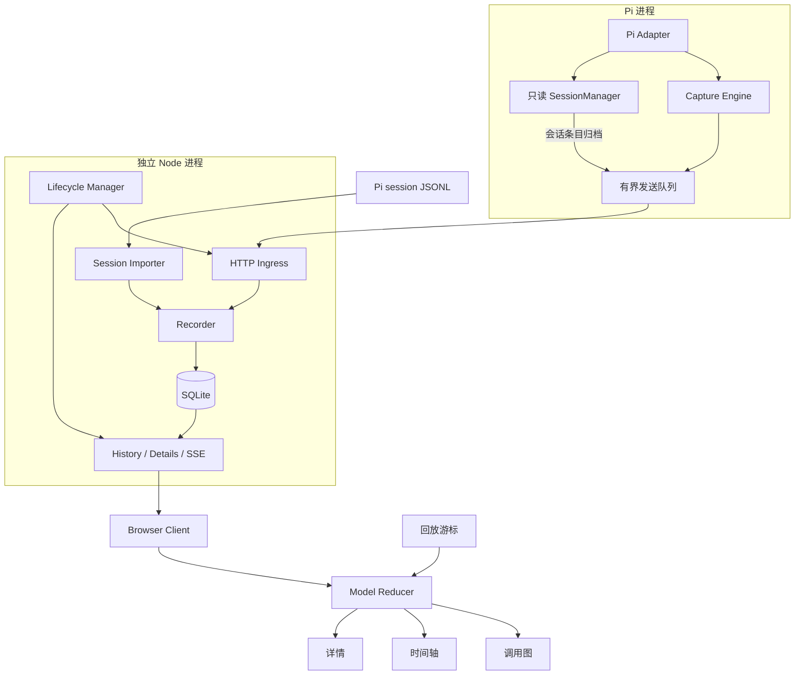

# Pi Loop Observer 编码设计总览

更新：2026-10-05。本文集保留编码前的设计契约；当前已完成首版代码和 [v0.2 试用反馈优化](usability-improvements.md)。已实现行为、验证证据和未完成项见[验收记录](acceptance.md)、[项目 README](../../README.md)和[兼容性记录](compatibility.md)。下文的建议接口与计划不自动等于已交付功能，以代码与验收为准。

## 阅读顺序

1. [领域模型与事件契约](domain.md)：先统一“问题、轮次、模型响应、工具执行、消息、分支、时钟”的含义。
2. [采集、导入与生命周期](capture.md)：实现自动记录、`/obs`、服务启动、会话关联。
3. [存储与传输协议](storage-protocol.md)：实现幂等落盘、查询、SSE 补齐、故障恢复。
4. [网页与可视化](web.md)：实现状态订阅、调用图、时间轴、详情和回放。
5. [编码顺序与验收](roadmap.md)：按可独立验证的交付切片推进。
6. [数据库建表草案](schema-v1.sql)：可在临时 SQLite 中检查结构，尚未作为正式 migration。

相关背景：[产品设计](../design.md)、[技术栈](../tech-stack.md)、[参考项目分析](../provider-trace-reference.md)。产品范围以最新设计为准，本文细化其实现。

## 固定产品行为

- 已启用扩展的 Pi 会话从 `session_start` 自动记录，浏览器是否打开不影响记录。
- `/obs` 打开当前会话的网页。Pi 已退出时，用未来的 `pi-loop-observer open` 启动历史查看服务；这个入口只打开网页，不实现终端可视化。
- Pi 活跃或存在网页查看者时保留本地服务；两者均不存在并超过宽限期后退出，数据不自动删除。
- 默认粒度为 Prompt → Turn → LLM / Tool；消息内容作为详情。Pi `/tree` 的底层条目是内容与分支基础，Observer 补充时序与运行阶段。
- steer 属于当前问题并区分提交/生效；followUp 开新问题。无法可靠关联时显式标记未知。
- 阶段回放，不做逐 token 历史重播；子 agent 先作为工具节点。
- 首版数十到数百个调用节点，桌面与窄屏可用；网页只读，不控制 agent。

## 架构与依赖方向



`model` 不导入 React、Pi、Node fs、数据库或 HTTP。`adapter` 可以导入 Pi 类型与 model 契约，不能导入网页模块。`server` 编排 recorder/lifecycle/model，但不执行 Pi prompt 或工具。`web` 只导入纯 model 和协议 DTO，不打包 Node/Pi SDK。

## Module / Interface / Implementation 约定

一个 Module 对外提供少量 Interface，隐藏复杂 Implementation。Interface 不仅指 TypeScript 签名，还包括顺序、错误、资源释放、性能与数据所有权约定。

只在确实存在替代实现的 Seam 定义 Adapter：真实 Pi 与 fixture 事件源、SQLite 与测试记录器、真实时钟与测试时钟。内部函数可以拆文件，不必每个文件都新增一套公开接口。

| Module                     | 主要功能                   | 最小对外 Interface                        | 内部编写思路                                     |
| -------------------------- | -------------------------- | ----------------------------------------- | ------------------------------------------------ |
| Contracts / Model          | 事件、状态、身份、归约     | `reduce`、`project`、DTO                  | 判别联合类型、纯函数、固定事件序                 |
| Capture Engine             | 将官方事件转为观察事实     | `accept`、`stop`、`health`                | 运行身份、阶段转换、工具 Map、有界内容预览       |
| Pi Adapter                 | 注册事件与 `/obs`          | 扩展 default factory                      | 只读官方事件，session 时启动资源，shutdown 清理  |
| Session Importer           | 已有 JSONL/内存条目归档    | `importSession`、`ingestEntries`          | 版本检测、父链重建、内容复制、增量导入与去重     |
| Reconciler                 | 实时身份与源条目关联       | `reconcileTurn`                           | 优先明确 entry ID / toolCallId，关联本身作为事件 |
| Transport Queue            | 非阻塞采集与批量重发       | `offer`、`flush`、`close`                 | 单生产者顺序、不可变批次、持久确认、溢出缺口     |
| Lifecycle                  | 服务发现、启动、租约、退出 | `ensureService`、`acquireLease`           | 单用户数据目录一实例，独立子进程，启动锁         |
| Recorder                   | 事务落盘与派生索引         | `appendBatch`、`readPage`、`readPayload`  | SQLite 是权威日志，投影可重建，先提交后通知      |
| Local Server               | 路由与实时事件出口         | HTTP / SSE 契约                           | 校验、鉴权、分页、DB 游标补发；不包含领域推断    |
| Browser Client / Store     | 连接、装载、同步状态       | `openSession`、`subscribe`、`getSnapshot` | 高水位历史 → 增量；实时状态与回放状态分开        |
| Graph / Timeline / Details | 图形与内容联动             | view-model props 与选择回调               | React Flow、稳定分层布局、SVG 比例尺、按需详情   |
| Replay Controller          | 暂停、定位、逐阶段         | `seek`、`play`、`pause`、`followLive`     | 对事件前缀执行同一个 reducer，不访问执行接口     |

## 建议文件组织

```text
src/
  model/{events,entities,reducer,projection,clock,capabilities}.ts
  adapter/{index,pi-events,session-context}.ts
  capture/{engine,correlation,stages,preview,queue,transport}.ts
  importer/{index,jsonl,entries,reconcile}.ts
  lifecycle/{client,registry,launcher,leases,config}.ts
  recorder/{index,schema,migrations,append,queries,projection}.ts
  server/{main,app,auth,ingress,history,stream,details}.ts
  cli/{main,open}.ts
web/src/
  app/{App,SessionPicker,ObserverPage}.tsx
  client/{api,stream,bootstrap}.ts
  state/{session-store,view-store,replay}.ts
  graph/{GraphView,layout,node-types,edges}.tsx
  timeline/{TimelineView,scale,lanes}.tsx
  details/{DetailsPanel,ContentView,EventList}.tsx
  styles/{tokens,layout}.css
  styles/*.module.css
test/
  fixtures/                   # 去除真实工作区数据的可控事件
  unit/ integration/ e2e/
design/                       # 保留既有效果稿
```

文件名与目录是责任落点建议，不要求先创建所有空文件。先完成一条可运行链路，再按复杂度拆分；单 package + pnpm，无需先上 monorepo 工具。

## 版本与证据

- 本机检查包为 `@earendil-works/pi-coding-agent@1.0.0`。详细事件结构依据安装包的 `extensions/types.d.ts`、`agent-session.js`、`session-manager`；公开交叉参考为 [Pi a276dabe](https://github.com/earendil-works/pi/tree/a276dabe57911253350bffb93cb7d7aff6a73261)。安装包与远端同版本不代表内容完全一致。
- 当前 `turn_end` 提供 `messageEntryId`、`toolResultEntryIds`，比早期基线更方便精确关联；`message_end` 回调时该消息可能尚未写入会话。
- 输入队列语义、provider 尝试身份、嵌套工具事件透传仍须 P0 验证。类型声明存在字段，不等于每条运行路径都提供它。
- 参考 [pi-provider-trace 2ec3fd4](https://github.com/Dwsy/pi-provider-trace/tree/2ec3fd46640c38bc81eeb766d29333f7cce853c3) 的分层和详情组织；本设计另行实现持久游标、阶段回放与独立服务。

所有接口片段都是设计示意。未知类型名称须按实际锁定版本补齐，不应直接宣称可复制编译。

## 本次文档校验记录

2026-10-04：检查 Markdown 代码块闭合、文件间链接、`/obs` 命令命名。将 SQL 草案在 Python 标准库提供的隔离内存 SQLite 中执行，确认 11 张业务表可创建，并检查 eventId/producerSeq 唯一约束、payload 外键及完整性取值约束。

这只验证文档和建表草案，不等于 better-sqlite3 安装、迁移实现、Pi 接入、SSE 或前端功能已通过测试；这些仍按 [编码顺序与验收](roadmap.md) 执行。
