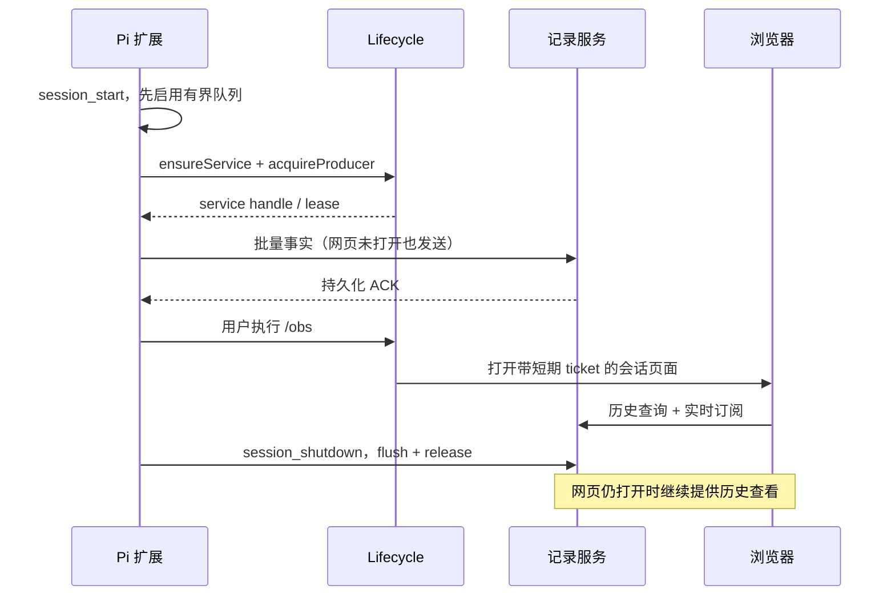

# 采集、导入与生命周期

返回[总览](README.md)。依赖[事件契约](domain.md)，输出遵循[存储协议](storage-protocol.md)。

## 1. Pi Adapter Module

### 功能与 Interface

扩展 factory 只注册官方事件、`/obs` 和可释放回调。`session_start` 才创建 Capture Engine、队列、服务连接和租约。所有观察回调不返回变换 payload、阻止工具或继续 agent 的控制结果。

```ts
export default function install(pi: ExtensionAPI): void {
  // 本文件只做装配；event/context 适配集中在 pi-events.ts。
  pi.on('session_start', async (event, ctx) => { /* begin epoch */ });
  pi.on('session_shutdown', async (event, ctx) => { /* bounded flush + dispose */ });
  pi.registerCommand('obs', { description: '打开执行观察器', handler: async (_args, ctx) => { /* open */ } });
}
```

这只是装配示意：不要机械地把每个捕获回调都写成等待网络的 async 函数。Pi 可能等待扩展 handler；高频回调必须只取必要字段、记时间、入队后返回。

### 官方事件到观察事实

| Pi 事件 | 编写思路 | 不可做的推断 |
| --- | --- | --- |
| session_start | 读取 session ID/file/cwd/leaf，启动 epoch，归档当前已有条目 | 不把恢复的旧消息标为刚执行 |
| input | 记录 submission 与 source/streamingBehavior | 输入可能被后续扩展消费/改写，不等于已应用 |
| message_start(user) | 创建应用候选，等待来源关联 | 不仅凭文本相等认定 steer/followUp |
| agent_start/end | 建底层 run、结束当前低层段 | agent_end 不是最终 settled |
| turn_start | run 内 turnIndex 定位新 turn | turn 计时包含工具，不能当 LLM 耗时 |
| message_start(assistant) | 创建响应 span，记录 mono start | 不宣称精确 HTTP 请求起点 |
| message_update | 按 thinking/text/toolcall 区块更新阶段，合并 preview | toolcall 参数流不是工具开始执行 |
| message_end | 保存观察到的最终消息、结束响应生成 | 此刻可能尚未写入 SessionManager，也可能被后续 handler 修改 |
| tool_call | 记录已声明/待执行参数，可补 span 关联 | 可能被拦截，不能当执行开始 |
| tool_execution_start/update/end | 用作用域内 toolCallId 管理执行 span 与结果 | 工具结果可能被后续 tool_result/message handler 改写 |
| turn_end | 读取明确 messageEntryId/toolResultEntryIds 做归档关联 | 不按两个数组位置盲目 zip，先取 entry 验证 role/toolCallId |
| agent_settled | 检查 pending inputs 和最终结果，收尾已关联 trace | 不能认为每个 followUp 都有独立 agent_start |
| ui_prompt_start/end | 记录等待用户的活动标记 | 没有可关联 ID 时不能精确归因到任意并行工具 |
| session_tree | 记录 oldLeafId/newLeafId 与新摘要 | 不删除离开分支的事件 |
| session_compact / failed | 归档新条目、标记上下文变化/失败 | 压缩不是历史事件删除 |
| session_shutdown | 按 quit/reload/new/resume/fork 结束 epoch | reload 不等于模型失败 |

before_provider_request / after_provider_response / provider_stream_event 为可选诊断来源。首版不依赖它们拼请求 ID，不采集鉴权 headers，不 patch fetch。类型存在 parentToolCallId 时仍需检查具体运行路径是否透传；对子 agent 内部 loop 不自动递归采集。

### 自动采集与打开查看



### `/obs` 行为

1. 获取当前 sessionKey，`ensureService()`。
2. 创建短时网页启动 ticket；用绝对 URL 打开当前会话。
3. 打开浏览器失败则在 Pi 通知中返回本地地址及重试提示，不回滚正在进行的采集。
4. 重复调用只复用服务/打开页面，不重复订阅 Pi 事件。
5. 无 UI 模式只提供适合该模式的提示/地址；采集仍可工作，不创建终端控件。

## 2. Capture Engine Module

```ts
interface CaptureEngine {
  accept(event: PiObservation): void;
  health(): CaptureHealth;
  stop(reason: StopReason, deadlineMs: number): Promise<FlushReport>;
}
```

### 内部状态

session context、producerId、runCounter、turnCounter、assistant span Map、工具 span Map、待关联输入队列、已归档 entry revision 集合、计时器、preview 合并器、录制质量状态。各 Map 按 session/run 作用域限定。

### 编写步骤

1. `pi-events.ts` 把版本相关字段转换成精简 `PiObservation`，领域逻辑不遍布 Pi 类型判断。
2. 一进入回调就记录 clockId/mono/wall；不要在异步 HTTP 发送后才计时。
3. 同步复制会被 Pi 后续修改的必要字段。delta 只取增量；最终 payload 采用有上限的快照，不能把活动 message 对象引用存入异步队列。
4. Capture Engine 生成状态变化事实与预览更新。预览每 50ms 合并一次作为起始参数；同一阶段的连续 delta 不重复写 stage_changed。
5. 将持久事实送队列，preview 走单独有界通道。`health` 提供 degraded/lastAck/lostCount 供 Pi 状态与网页使用。
6. stop 先停止新输入、生成停止事实、限时 flush，再释放租约/定时器。超时返回报告，不无限阻塞 Pi 退出。

### 问题边界与输入关联

- 正常空闲输入：input.submitted 先记；实际 user message 被应用后建立 trace。
- 明确 steer：提交 marker 可先显示在当前问题；实际应用 marker 只有获得消费证据后记录。不能以提交时刻代替生效时刻。
- 明确 followUp：先建 queued 输入项；真正应用后建立新 trace，并保留等待段。
- 相同文本、多次提交、模板展开、其他扩展 transform/handled、队列撤回：用 P0 验证公共事件能否给出无歧义映射；禁止以字符串相等作为唯一匹配条件。
- 没有可靠关联证据：保留 submission 与 applied message 两项，kind=unclassified，显示“输入归属未确认”。不改 Pi 控制流来强行获得 ID。
- 如果公共接口无法满足完整 steer/followUp 语义，先交付明确受限的正常输入链路，并在支持矩阵标注限制；不能宣称全部已支持。最小上游接口需求应单独记入 P0 结果。

## 3. Reconciler Module

### 最小 Interface

`reconcileTurn(boundary, readonlySessionManager)` 返回 `entry.archived`、`entity.bound`、`relation.observed` 事实列表，不直接改数据库或前端节点。

### 推荐算法

1. turn_end 到来后，根据 `messageEntryId` 调用只读 `getEntry`，确认它是当前 session 的 assistant 条目。
2. 找到本 turn 已观察的响应 span。存在多个候选时，只有额外身份/经过验证的对象对应关系唯一才绑定；不按最近时间挑一个。
3. 对 toolResultEntryIds 逐条取 entry，检查 role=toolResult，从 entry.message.toolCallId 回到作用域内工具 span；嵌套工具没有普通条目时保持独立观察，不伪造 entry。
4. 存储源条目最终内容，再追加 binding。Observer 执行事件与会话最终消息的差异作为不同来源保留。
5. 由 assistant.content.toolCall 和结果条目建立有证据的关系；后续 assistant 上下文消费关系只有能确认处才连接，否则只表达时间/轮次顺序。
6. message_end 不查“最后一条 entry”来猜自己的 ID。没有 turn_end 的失败/退出路径，以缺口状态收尾，后续导入可补内容，但不能补出未观察的时间。

## 4. Session Importer Module

### 功能与 Interface

```ts
interface SessionImporter {
  importSession(input: ImportInput): AsyncIterable<ImportProgress>;
  ingestEntries(session: SessionIdentity, entries: SourceEntry[]): Promise<ImportReport>;
}
```

真实 Adapter 为 Pi JSONL；测试 Adapter 为内存条目序列。自动会话归档使用只读 SessionManager；浏览器历史导入使用用户选择/已配置的 session 路径。不要扫描工作区的所有文件。

### JSONL 读取流程

1. 读取 header，识别格式版本、sessionId、cwd 和父会话线索；未知版本明确返回 unsupported-version。
2. 按字节块流式读取，用换行切条目，维护 byteOffset 与未结束行。正在写入的最后半行等待下次，不直接当坏数据丢弃。
3. 建 entryId → entry 索引，验证 parent 是否存在。导入顺序不等于展示父链；缺失父条目标记缺口，检测环。
4. 以 `(sessionKey, entryId, revisionHash)` 去重；同 ID 内容变化保存新 revision 事实，不静默覆写旧记录。
5. 将必要正文、工具参数/结果及元数据复制到 Observer archive，不能只保存外部文件路径。
6. 给无时序的 assistant/toolResult 建历史内容节点，timing=unknown；不创建虚构的开始事件和持续时间。
7. 文件改名/替换时根据 header 与已知 fingerprint 判断恢复；文件缩短或内容冲突记录 import warning。`fs.watch` 只作提示，不能作为完整性保证；显式扫描/增量重读负责恢复。
8. progress 包含已导入数、跳过数、截断/坏行、缺失父条目和支持能力；不能吞错误后报告成功完整。

无 session 文件的 `--no-session` 场景，仍可通过实时事件归档必要最终内容；把 sourceFile 标为空并使用会话/epoch 身份，不让数据库路径依赖文件名。

## 5. Queue / Transport Module

```ts
interface CaptureQueue {
  offer(fact: UnsequencedFact): OfferResult; // 同步、内存有界
  flush(deadlineMs: number): Promise<FlushReport>;
  close(): void;
}
```

- 第一次接受持久 fact 时分配 eventId/producerSeq；重试复用原值。每 Producer 只保持一个在途批次，保证连续确认。
- 服务返回 ackedThrough；队列只清理确认以前的事件。HTTP 成功但确认丢失时重传，相同 seq+内容应返回原确认。
- 网络退避采用上限与 jitter；服务故障时继续运行 Pi，并报告 degraded。租约心跳与数据批次可分开，避免长批次把健康误判。
- 先合并/舍弃 preview，再拒绝新的 durable fact。为 `capture.gap` 预留空间；被拒绝 fact 不先分配 seq，累计丢弃计数并在可用时发送 gap。
- 不删除已分配但未确认的 durable 事件来腾空间。极端内存压力下停止本轮捕获并显式告警；无法落盘时不能声称完整记录。
- 只有已提交数据具备恢复保证；首版内存 outbox 在进程崩溃时会丢失队尾。Pi session 可补内容，不可补齐精确时序。

起始调参建议：50ms 批量窗口、最多 128 个事实/批、约 1MiB 传输上限、队列 8MiB、正常退出最多 2s flush。数字不是性能承诺，配置需按字节与事件数同时限流；大 payload 单独按块归档后引用。

## 6. Lifecycle Module

### 配置 Module

`resolveConfig(overrides, env, persistedConfig)` 只返回已校验配置，不启动资源。统一管理 dataDir、loopback 监听、队列/批次字节上限、flush deadline、心跳与 idle grace。优先级为显式启动参数 > 环境变量 > 配置文件 > 默认值。进程私有凭据不写进可分享配置。预览端不自行推断后端端口。

### 数据目录与发现

建议默认 `~/.pi/loop-observer/`，允许 `PI_LOOP_OBSERVER_DIR` 覆盖；实际路径通过配置统一解析，调用者不拼接隐藏常量。下面是待实现布局：

```text
loop-observer/
  observer.sqlite
  observer.sqlite-wal / observer.sqlite-shm
  runtime.json          # 活跃实例、URL、协议版本、私有凭据
  startup.lock/         # 启动互斥，含实例身份/创建时间
  service.log           # 轮转的服务诊断日志，不是业务事件来源
```

首版一个用户数据目录对应一个服务和单个 DB writer；多个 Pi 实例是多个 producer，各自 session/epoch 隔离。UI 仍聚焦单问题，不因此扩展成多 agent 调度系统。

```ts
interface LifecycleClient {
  ensureService(): Promise<ServiceHandle>;
  acquireProducer(handle: ServiceHandle, identity: ProducerIdentity): Promise<ProducerLease>;
  openViewer(handle: ServiceHandle, selection?: ViewerSelection): Promise<OpenResult>;
}
```

### 启动流程

1. 读 runtime.json，以实例 ID + 协议版本 + 已认证健康检查确认活实例。不能仅凭 PID 或端口有响应即复用。
2. 获取原子启动锁，再检查一次活实例，避免双启动。
3. 用当前 Node 可执行文件启动打包后的 server/main.js 独立进程，脱离父进程 stdio；诊断写 service.log。
4. 服务迁移数据库成功后监听 loopback 动态端口，原子写 runtime.json；启动者限时等待就绪。
5. 启动成功释放锁。失败保留诊断并清理属于自身的运行标记；不能未经身份/liveness 检查删除别的活实例锁。
6. 服务启动前先接收内存事件，连接就绪后发送；不为等待服务而长时间阻塞 Pi。

### 租约和退出

采集者、浏览器与进行中的历史导入分别持有租约。建议 producer 心跳 5s、过期 30s，viewer 使用 SSE 活连接及续租，失联宽限 120s，无任何租约后再 idle 60s；全部是可调起点。

服务退出状态：ACTIVE → IDLE_GRACE → DRAINING → STOPPED。DRAINING 中新租约请求返回可重试响应或原子取消退出；不能一面接收新 batch 一面关 DB。等待已接受事务完成，关闭 SSE，关闭数据库，仅删除匹配本实例的 runtime 描述。

浏览器后台节流不能仅靠 JS setInterval 判活；服务端连接状态和心跳共同判断。机器睡眠可能让租约失效，应标为“采集连接状态未知/缺口”，不能当作工具真实失败。Producer 重连后恢复状态要由真实事件确认；gap 留存。

`session_shutdown` 有 reload/new/resume/fork 等原因：旧 epoch flush/release，新 session_start 重新 acquire，不要求重启服务器。Pi quit 后还有网页则服务继续；没有网页则按宽限期结束。下次 `pi-loop-observer open` 单独拉起服务，不导入 Pi SDK 或执行模型。

### 测试入口

注入 Clock、ProcessLauncher、RegistryStore、BrowserOpener，分别提供真实与测试 Adapter。测试依赖 Interface 的可见行为：双启动只得到一个实例、Pi 退出后查看可用、断链不误报 agent 失败、失败启动不遗留有效 runtime、正常 reload 不重复采集。
