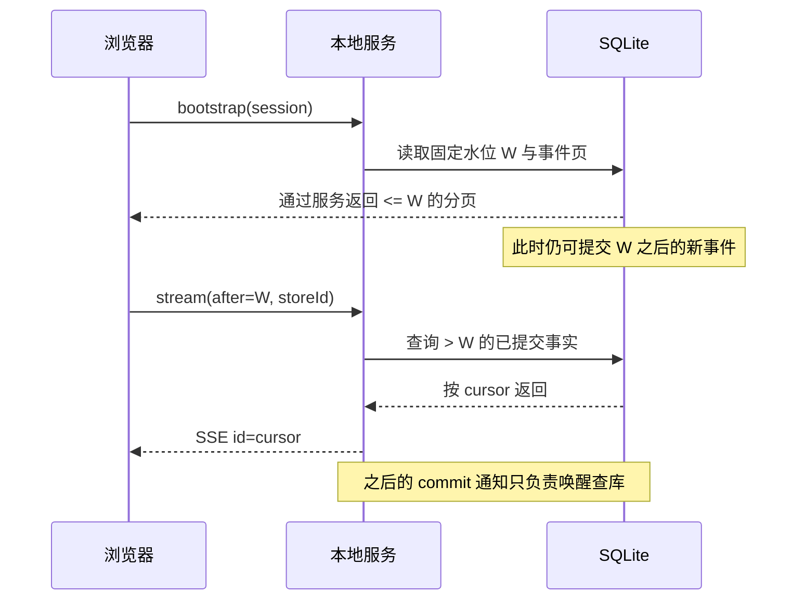

# 持久化与传输协议

返回[总览](README.md)。本页定义 Recorder 与 Local Server Module，SQL 草案见 [schema-v1.sql](schema-v1.sql)。所有路由是拟实现契约。

## 1. Recorder Module

### Interface

```ts
interface Recorder {
  appendBatch(batch: EventBatch): AppendAck;
  readPage(query: { sessionKey: string; after: Cursor; through: Cursor; limit: number }): EventPage;
  readPayload(query: PayloadSliceQuery): PayloadSlice;
  getWatermark(): Cursor;
  close(): void;
}
```

真实 Implementation 使用 better-sqlite3；fixture 用内存 Adapter，二者执行同一契约测试。Recorder 不负责浏览器或网络连接。每次首次建库写入稳定 storeId；从空库恢复或显式换库时生成新身份。事件、内容和当前派生索引写入同一事务；只有事务提交后才发 commit 通知。

### 数据表职责

| 表 | 职责 | 不变量 |
| --- | --- | --- |
| store_metadata | 数据库实例身份 | 首次建库生成 storeId，重启保持不变；新建/重置库换 ID |
| sessions | 会话目录与来源 | source_file 可以为空或失效，不影响归档查询 |
| producers | 采集 epoch 与确认位置 | last_acked_seq 只前进，不跨缺口 |
| events | 权威追加事实 | eventId、producer+seq 唯一；不可就地改写历史 |
| payloads / payload_chunks | 归档的大内容 | hash、实际字节数、完整性明确；提交后不可改 |
| event_payloads | 事实引用的内容 | 返回 ACK 前确认全部引用存在 |
| source_entries | Pi 条目归档索引 | 同条目相同 revision 幂等；源父条目可暂时缺失 |
| source_bindings | 当前精确关联索引 | 可从 entity.bound 重建；不用于伪造过去状态 |
| session_projections | 最新状态缓存 | 带 reducerVersion 与 throughCursor；可删掉重建 |
| schema_migrations | 数据库版本 | 新 schema 不兼容时停止启动并解释，不尝试猜读 |

初版无需 ORM；用预编译 SQL 与小型映射函数。源条目的 parent 不设强外键，因为增量导入可能先看到子条目；Importer 负责校验并报告缺失。

### 写入算法

1. 校验 storeId/协议版本、producer/session 归属、事件 envelope、batch 大小、引用 payload 是否完整。信封 refs 与 fact 重复携带同一身份时必须一致。
2. 开短事务。针对已存在的 producerSeq 比较 canonical 内容 hash：相同即重试，返回原 cursor；不同则 `409 sequence_conflict`，不覆盖。
3. 新 seq 必须从 lastAck+1 连续递增，缺口返回 expectedSeq。一个批次可以包含已确认前缀与连续新后缀。
4. 按顺序插入 events，写 event_payloads / source_entries / bindings，更新当前 projection 和 producer ack。
5. 事务失败全部回滚，不发布 SSE，不返回成功 ACK。
6. commit 后触发“有新数据”通知；通知失败不影响落盘，SSE 下次从 DB cursor 继续读取。

ACK 被网络丢弃时允许整个批次重传。Content hash 覆盖 canonical EventDraft，排除服务端 cursor/receivedAt；同 eventId 被另一 seq 重用也是冲突。

### SQLite 运行参数与恢复

建议本机磁盘、WAL、foreign_keys=ON、synchronous=FULL、有限 busy_timeout。Cursor 读取在 better-sqlite3 启用安全整数/BigInt 模式，序列化显式转十进制字符串；producerSeq 校验 Number.isSafeInteger 且大于零。FULL 是偏向记录可靠性的默认建议，事务批处理抵消部分成本；实际延迟需验证。WAL 仍只有一个 writer，且不消除同步 JS 阻塞。[SQLite 官方说明](https://sqlite.org/wal.html)

启动按顺序执行迁移、恢复 producer 信息、确认投影版本。升级 reducer 时只重建投影，不改原事件。不能把服务重启直接判为所有 agent 失败：先等待采集者重连或租约判定，再追加质量缺口/采集状态事实。

服务发现新库 storeId 与发送者原实例不同，返回 store_changed；采集者不能沿用之前的 ACK 推断新库已有那些事件，必须报告归档切换/缺口并重新建立 producer，必要时重导 Pi 内容。

数据库写入失败要传递到上层健康状态。磁盘满时不可丢弃旧记录来“自动恢复”；停止确认新数据，让采集队列退避并最终明确降级。

## 2. Payload 归档

标准事件正文只包含结构信息、短摘要与 contentRef，不把完整模型结果反复塞进每个增量。

- 小内容可随批次一次归档；大内容通过上传模块分块接收，完整校验后才加入 committed payload 表，再允许事件引用。
- 上传 staging 与业务 archive 分开；未完成上传不能被详情端点当完整内容读取。上传 ID、chunk index、hash 用于重试去重。
- 初始分块建议 256KiB。按实际字节处理 UTF-8，不用字符串字符数作字节边界；服务保存原字节，显示端按编码解码。
- hash 一致可复用内容块，但不同 source/节点引用仍保留各自元数据。客户端不把相同文本当成同一次调用。
- 对于超过配置限额的输出，必须记录 explicit truncated/missing 与原大小（已知时）；不得返回“完整”标志。最终限额是部署参数，先用 fixture 测试大输出，不在设计里承诺无限保存。
- HTML/Markdown/工具输出作为不可信内容显示；详情不执行脚本、不主动请求内容中的远端资源。

schema-v1.sql 给出 committed payload 表。staging 只属于 Upload Module 内部，初版实现时可使用受限临时目录及原子 finalize；异常退出的未提交上传按过期策略清理，不删除已提交内容。原子 finalize 过程要保证：payload 元数据与 chunks 同事务提交、事件只能引用已完成的 payload。

## 3. Local Server Module

功能：启动 Hono、提供静态资源、校验入站数据、调用 Recorder、输出查询/SSE。所有运行态写接口只涉及 Observer 自己的记录与租约，没有 prompt、工具执行、steer、abort 路由。

### 路由表

| 方法与路径 | 输入 / 输出 | 调用模块 |
| --- | --- | --- |
| GET `/health` | 实例 ID、协议版本、ready/degraded；不泄露数据 | Lifecycle |
| POST `/internal/producers` | 身份 → producer lease 与已确认 seq | Lifecycle + Recorder |
| POST `/internal/producers/:id/heartbeat` | lease → renewal | Lifecycle |
| DELETE `/internal/producers/:id` | lease → release；不删除记录 | Lifecycle |
| POST `/internal/events/batch` | EventBatch → AppendAck | Recorder |
| POST `/internal/payloads/uploads` | manifest → uploadId | Upload |
| PUT `/internal/payloads/uploads/:id/:part` | chunk bytes → part ACK | Upload |
| POST `/internal/payloads/uploads/:id/complete` | manifest/hash → payloadId | Upload + Recorder |
| POST `/auth/bootstrap` | 一次性 ticket → viewer cookie | Auth |
| POST `/api/viewers/heartbeat` | viewer lease renewal | Lifecycle |
| GET `/api/sessions` | 可分页会话目录、摘要和质量 | Recorder projection |
| GET `/api/sessions/:key/bootstrap` | 当前目录、watermark、首个事件页 | Recorder |
| GET `/api/sessions/:key/events` | after/through/limit → EventPage | Recorder |
| GET `/api/sessions/:key/stream` | after → SSE | Stream |
| GET `/api/sessions/:key/nodes/:id/details` | asOf cursor、分页 → Details | Recorder/model |
| GET `/api/payloads/:id` | sessionKey/nodeId/asOf/offset/limit → 内容切片 | Recorder |
| GET `/api/sessions/:key/preview` | 当前内存 preview snapshot | Preview |

历史文件导入首版由独立 `open --session <path>` 启动入口调用 Importer，或自动归档当前 Pi session；不要提供浏览器任意路径读取接口。高级目录选择与批量导入可后续增加。

### DTO 示意

```ts
type EventBatch = { protocolVersion: 1; storeId: string; producerId: string; events: EventDraft[]; payloads?: PayloadDraft[] };
type AppendAck = { producerId: string; ackedThrough: number; lastCursor: Cursor };
type EventPage = { events: StoredEvent[]; nextAfter: Cursor; through: Cursor; done: boolean };
type Bootstrap = { storeId: string; session: SessionSummary; watermark: Cursor; firstPage: EventPage };
```

`PayloadDraft` 表示随批次提交的小内容清单，含 hash、mime、byteLength、bytes 和完整性；它与事件引用同事务落盘。大内容先走 Upload Module。

`nextAfter` 是本页最后已消费事件 cursor；没有事件时 done=true。through 固定本次历史快照的高水位，不随分页变动。Cursor 参数解析为非负 BigInt，并绑定当前 storeId；不同数据库或无效游标返回显式错误。

错误统一 `{error:{code,message,retryable,details?}}`：bad_request、unsupported_schema、store_changed、sequence_gap、sequence_conflict、payload_missing、storage_unavailable、cursor_invalid、unauthorized。记录验证失败不可伪装 HTTP 200。错误日志不打印整段用户输入或鉴权 token。

## 4. 无遗漏的历史 → 实时接续

### 首次打开

1. bootstrap 在一致读视图获取 `W = max(cursor)`，返回首个 `cursor <= W` 的该 session 事件页。
2. 浏览器继续按 after/through=W 分页归约。即使期间有新写入，也不混入历史页。
3. 历史加载完成后，从 `after=W` 建立 SSE。期间的新事件仍在数据库中，服务会补发，所以不要求先开 SSE 再查历史。
4. 网页显示 loading/progress，不把尚未加载的历史当成不存在。正文在详情单独请求，历史页只载结构事实。
5. 若 session 很长，分页流式归约，避免单个巨大 JSON；首版优先验证 5000 个结构事实的测试集，超过该量继续分页并展示进度，不静默截断。后续可加入版本化快照优化。



### SSE 服务循环

通知仅用于唤醒，数据库才是事件来源。启动订阅后，循环查询 session 中 `cursor > lastSent` 的事件，按 cursor 升序批量输出；没有数据时等待新提交或定时检查。

```text
订阅 commit 唤醒
while connection open:
  generation = 当前唤醒计数
  page = DB.readAfter(lastSent, limit)
  if page 非空:
    顺序 await write(event: fact, id: cursor, data: StoredEvent)
    每次写成功后更新 lastSent
    continue
  若唤醒计数已变化: continue
  等待唤醒 / 1秒兜底 / 连接取消
finally: 释放监听器与查看租约
```

注册唤醒必须早于第一次查询；generation 检查防止“查到空之后、开始等待之前”错过通知。轮询兜底使进程内通知丢失不导致永久停更。不得从一个有限内存 ring 假装完整补发历史。

SSE 示例：

```text
id: 1842
event: fact
data: {"cursor":"1842","eventId":"…","sessionKey":"…","fact":{"type":"span.ended","spanId":"…","outcome":"completed"}}

: heartbeat

```

示例 data 为节选，真实 StoredEvent 必须包含完整信封。浏览器按 eventId/cursor 幂等应用；重连优先 `Last-Event-ID`，否则使用 after。stream 请求携带 storeId；服务校验 cursor 对当前 store 有效。切换 session 时关闭旧连接并重建，不复用上个 session 的游标。

SSE `id` 帮助客户端携带重连位置，服务仍需显式实现数据库补发。[SSE 规范行为说明](https://developer.mozilla.org/en-US/docs/Web/API/Server-sent_events/Using_server-sent_events)

### Preview 通道

采集者发 preview 时携带 baseProducerSeq；服务只有在该 producerSeq 已提交后，才映射出 baseCursor 并对外发送。尚未提交的 preview 有界暂存或丢弃，不能先于对应开始事实暴露。

对浏览器的 preview 包含 producerId/spanId/previewVersion/baseCursor，不分配 durable cursor，不设置 SSE id；它不能推进 Last-Event-ID。网页先具备 baseCursor 对应状态才应用；完成事实优先，迟到 preview 不让节点重新运行。重连后 `/preview` 可取当前快照，或者等下次 preview。历史回放完全不消费 preview。

### 慢客户端

await 写入并遵守背压，但不能让一个慢网页阻塞 DB 提交。每个连接设有限待发预算/超时，超限关闭该连接，之后从持久 cursor 补齐。一个 session 的多个网页互不共享 lastSent。

## 5. 本机访问与资源归属

- 服务绑定 loopback；进程接口使用私有 bearer 凭据，runtime.json 权限限制为当前用户。
- 打开网页时把短期一次性 ticket 放 URL fragment；网页向 bootstrap 换取 HttpOnly、SameSite 严格的会话 cookie，随后清除 fragment。EventSource 通过同源 cookie 鉴权，不把长期 token 放 query。
- 检查 Host/Origin，不开放任意跨域；禁止浏览器直接访问 internal ingestion。
- 历史详情按当前查看 session/节点/游标校验 payload 可见性；不能只因 payloadId 可猜就放行。
- 大输出分页读取；HTML 转义/安全 Markdown；服务状态错误与工具执行错误分开展示。

## 6. 存储与协议验收

1. 同 batch 两次发送只新增一次事件；相同 seq 不同内容返回冲突。
2. commit 成功、响应丢失、客户端重试后 ACK 前进正确。
3. payload 不完整时引用事务失败，既无 ACK 也无可见完成节点。
4. bootstrap W 后插入事件、分页间插入、SSE 订阅空档插入均恰好展示一次。
5. 断线期间工具结束，重连能恢复结束结果；preview 不能覆盖它。
6. DB 重启、投影重建、源 Pi JSONL 删除后已有归档可读。
7. 慢客户端/超大详情不阻塞采集；写失败能使健康状态降级。
