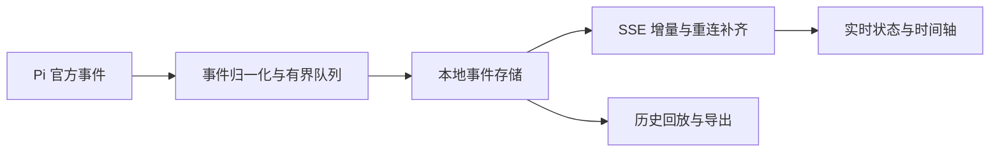

# Pi Agent 实时状态与 Loop 可视化扩展调研

调研日期：2026-10-03。项目基线：`earendil-works/pi`，提交 `6160683a4a8012f0d1cd30c145df18b4ca6f5176`。本轮使用仓库 README、package.json 与部分源码等一手资料；**没有安装运行候选，也没有实测流畅度、移动端布局或恢复可靠性**。远端默认分支和搜索缓存可能不同步，版本号是取证快照，不能视为锁定版本的兼容保证。

## 指定参考项目补充

用户已指定 pi-provider-trace 作为设计与实现参考，固定提交的详细源码分析见 [参考实现分析](provider-trace-reference.md)。当前仍为独立扩展路线，入口命令 `/obs`；较早的候选比较保留为调研快照。

## 结论

存在直接相关的开源项目，不能得出“没有现成扩展”的结论。优先验证 `@spences10/pi-observability` 与 `pi-provider-trace`；前者有本地实时事件基础，但源码中的 waterfall 实际是已完成工具耗时排行，后者更接近 Provider DevTools。**本轮尚未证实一个同时具备完整 LLM/工具共享时间轴、运行中状态、可靠问题边界和流畅交互的即装即用扩展。**若接受完整桌面客户端，可以进一步考察 Pi-Harness；若主要目标是长期追踪、成本分析和跨 Agent 关联，官方 Langfuse 插件更合适。

以下三个概念应分别验收：聊天步骤的顺序排列、带开始/结束时间的瀑布图、运行中尚未结束阶段的实时呈现。README 写了 timeline 或 observability，不代表三者都已实现。

## 候选比较

| 项目 | 已核实的一手资料内容 | 与需求的差距 / 取舍 | 许可证与版本线索 |
| --- | --- | --- | --- |
| [spences10/my-pi：pi-observability](https://github.com/spences10/my-pi/tree/main/packages/pi-observability) | 本地服务、SSE、事件搜索与详情、SQLite；源码确认 waterfall 仅提供已完成工具耗时排行 | 值得试用并评估二开，但未实现所需的完整共享时间轴；当前 summary 无 LLM/provider spans、无进行中条 | MIT；0.0.23，Svelte 5，Node ≥24.15，peer 新命名 Pi `*`；特定归因 header 需 Pi ≥0.80.4 |
| [Dwsy/pi-provider-trace](https://github.com/Dwsy/pi-provider-trace) | 本地 Web UI；Prompt → Turn → LLM/Tool/Message 树；Timeline、请求输入输出、工具关联；SSE 实时更新 | 很接近需求，但通过 patch `globalThis.fetch` 抓 HTTP/SSE；仅覆盖该传输路径，URL 筛选也有启发式限制。适合网络级调试，未必适合作为默认常开基础设施 | MIT；0.1.1；peer `@earendil-works/pi-coding-agent >=0.52.0` |
| [langfuse/pi-observability-plugin](https://github.com/langfuse/pi-observability-plugin) | 每个用户问题一条 trace，LLM、工具、成本、TTFT、子 Agent；源码在 `agent_settled` 收尾 | 适合完整 trace 留存；没有证据证明其 UI 能逐帧展示尚未结束的 LLM/工具阶段，不能把“采集实时事件”直接当作实时状态面板 | 插件 MIT；0.1.2；peer 新包名 `*`，开发依赖 Pi `^0.84.2`；官方标为 experimental |
| [wangmiaozero/pi-harness](https://github.com/wangmiaozero/pi-harness) | README 声称已提供 Run trace、span waterfall、播放/暂停/逐步回放、速度调整、Run Tree；同时含治理与编排 | 功能覆盖较广，但这是完整桌面应用。回放、真实 span 和流畅度仍需运行验证；引入范围显著大于只读观察扩展 | AGPL-3.0-only；抓取 package 为 1.7.1、Pi 0.87.1；README 已写 1.8.0，需锁定 commit 后验证 |
| [justhil/pi-app](https://github.com/justhil/pi-app) | SDK worker 桌面应用；thinking/命令/读写步骤实时出现，回答开始后折叠摘要；Run 与 Context 面板、session tree | 更像流式聊天步骤时间线，未找到按实际持续时间缩放的 loop 瀑布图证据；适合作为清晰交互的设计参考 | MIT；Electron + React + TypeScript；package 锁 Pi 0.83.0，新包名 |
| [BlackBeltTechnology/pi-agent-dashboard](https://github.com/BlackBeltTechnology/pi-agent-dashboard) | Bridge Extension + WebSocket + React，和 TUI 共存；多 session、实时聊天/推理；React slot 插件体系 | 二开发扩展接口明确；未找到单问题时间瀑布/回放证据。若希望以后加控制、多 session，可作为宿主候选 | MIT；peer 同时列新旧包名；新 coding-agent ≥0.80.10，pi-ai ≥0.75.5 且 <0.87.0 |
| [summertime-wu/pi-tps](https://github.com/summertime-wu/pi-tps) | TUI TPS widget、工具监控、TTFT、waterfall trace；配置 maxTraces/maxDetailed | 轻量且无需浏览器；不能据此推断支持完整历史回放、缩放、检索和丰富交互 | Pi 官方目录登记 MIT、1.0.1；最低 Pi 版本未核实 |
| [jcpowermac/pi-otel](https://github.com/jcpowermac/pi-otel) | agent_run → turn → generation/tool spans；OTLP、文件、console exporters；借助 Jaeger 查看 waterfall | 提供采集和标准 trace，不自带专用实时前端；README 仍以 agent_start/end 定义 run，需核查 settled/自动重试语义 | package 声明 MIT、0.2.0；未声明 Pi peer 版本，兼容性待测 |
| [mprokopov/pi-otel-telemetry](https://github.com/mprokopov/pi-otel-telemetry) | OTel traces/metrics、Grafana dashboard、Jaeger/Tempo 配置 | 适合运维；README 的 llm.request 是 turn 内 span event，不是独立 LLM duration span；不能直接满足细粒度 LLM 瀑布 | package 声明 MIT、1.0.0；peer 仍为 `@mariozechner/pi-coding-agent: *` |
| [agegr/pi-web](https://github.com/agegr/pi-web) | 浏览器 session 工作台，继续会话、运行状态、项目文件、分支 | 完整 Web agent 客户端；未找到单问题 loop waterfall 证据 | MIT；0.9.3；Next.js/React；锁新命名 Pi 0.99.1，与本项目基线不同 |

表中 UI 特性主要来自各仓库 README，不等同体验验收；许可证与兼容版本还参考以下 manifest：[pi-provider-trace](https://github.com/Dwsy/pi-provider-trace/blob/main/package.json)、[Langfuse 官方插件](https://github.com/langfuse/pi-observability-plugin/blob/main/package.json)、[pi-app](https://github.com/justhil/pi-app/blob/main/package.json)、[dashboard](https://github.com/BlackBeltTechnology/pi-agent-dashboard/blob/develop/package.json)、[Pi-Harness](https://github.com/wangmiaozero/pi-harness/blob/main/package.json)、[pi-web](https://github.com/agegr/pi-web/blob/main/package.json)、[pi-otel](https://github.com/jcpowermac/pi-otel/blob/main/package.json)、[pi-otel-telemetry](https://github.com/mprokopov/pi-otel-telemetry/blob/main/package.json)。pi-tps 内容来自 [Pi 官方包目录](https://pi.dev/packages/pi-tps)。

## 重点细节

### 本地扩展：pi-observability 与 pi-provider-trace

`pi-observability` 的文档给出默认 `127.0.0.1:43190`、本地数据库、事件 retention、bearer 验证与脱敏，并支持事件类型、时间戳和 session sequence。[README](https://github.com/spences10/my-pi/blob/main/packages/pi-observability/README.md) 技术栈与运行环境参考 [package.json](https://github.com/spences10/my-pi/blob/main/packages/pi-observability/package.json)。

但源码揭示了文档措辞与实际功能的差距：`trace_summary` 只从工具事件生成有开始和结束的 span，按 duration 倒序，截前 80；没有 provider/LLM span 的构建路径。前端 `waterfall-view.svelte` 只根据 `duration/max_duration` 画宽度，没有按 start offset 对齐，因此它是工具耗时排行榜，不能解释并行关系或完整 loop 的时间去向。另一个 Timeline 视图按 turn 分组事件列表，也不等于共用时间轴。应把它定位为“很好的本地采集与 UI 基础候选”，而不是已经满足完整需求。[summary 源码](https://github.com/spences10/my-pi/blob/main/packages/pi-observability/src/trace-summary.ts)、[waterfall 源码](https://github.com/spences10/my-pi/blob/main/packages/pi-observability/src/web/src/waterfall-view.svelte)、[timeline 源码](https://github.com/spences10/my-pi/blob/main/packages/pi-observability/src/web/src/timeline-view.svelte)

`pi-provider-trace` 文档明确区分持久事实与流式 snapshot：临时 stream update 不逐 token 落盘，最终 stream result 才持久化。它声称流式更新上限每 50ms 一次，支持桌面可调整面板和移动端单面板导航；这些说明设计考虑了负载与窄屏，但尚未实测。其 HTTP patch 与官方生命周期事件靠时间合并，仍需测试错误归属和多并发关联。[README](https://github.com/Dwsy/pi-provider-trace)

不能把其 README 对官方 hook 的限制泛化：调研时核对的 Pi 的 `message_update.assistantMessageEvent` 已提供归一化的 text/thinking/toolcall 流式事件。只有原始 HTTP/SSE 证据需要额外捕获；普通状态和 loop 可视化不必 patch fetch。[固定基线事件契约](https://github.com/earendil-works/pi/blob/6160683a4a8012f0d1cd30c145df18b4ca6f5176/packages/coding-agent/src/core/extensions/types.ts#L784)

### 官方 Langfuse 插件的真实边界

源码可确认它用新 `@earendil-works` API，在 `before_provider_request` 建 generation，监听消息和工具，根 trace 在 `agent_settled` 结束并 flush。它还处理中断观察对象和 provider retry。前端是否及时显示“正在运行”的未结束 observation，需要额外验证；当前能成立的结论是“成熟 trace 后端方向”，而非“已验证实时状态体验”。插件开源许可证不代表 Langfuse 所有企业功能具有相同许可。[源码](https://github.com/langfuse/pi-observability-plugin/blob/main/src/index.ts)

同类 [hdkiller/pi-langfuse](https://github.com/hdkiller/pi-langfuse) 也公开了 prompt → turn → generation/tool 模型并声明 MIT；本轮未核实其当前最低版本，故不排在新命名、官方维护插件之前。

### 不属于这次核心需求的项目

[npxcnency-ux/pi-trace-extension](https://github.com/npxcnency-ux/pi-trace-extension) 是 MIT 的本地调用树查看器，实时追加 `events.jsonl`，但 `/trace` 或 session shutdown 才生成静态 `trace.html`。适合离线复盘与 UI 参考，不能把实时落盘等同于浏览器实时显示。[官方包目录](https://pi.dev/packages/pi-trace-extension)

[Observal/pi-insights](https://github.com/Observal/pi-insights) 扫描已存在的 session 历史，生成自包含 HTML 使用分析报告；它是 AGPL-3.0 历史洞察工具，不是运行中的 loop 观察器。

## 建议的试用与二开发判定

先用固定的本地假模型和可控工具，给首选扩展喂同一套脚本事件：两次 LLM 往返、两个并发工具、一个工具失败、自动 retry、compaction、abort、follow-up。不要用“聊天看上去很顺”代替 trace 正确性验证。

验收时至少检查：

1. **当前状态真实**：等待首 token、流式生成、工具执行、重试等待能区分；多个工具并发不能挤成单状态。
2. **问题边界准确**：一次用户问题跨多个 turn、retry 与 compaction 能聚合；不能在第一个 `agent_end` 误报完成。
3. **时间可靠**：每个 span 有起止与父子关联；运行中条持续延长；不能把工具时间算进 LLM 时间。
4. **交互可用**：时间条选择联动事件详情；可折叠 turn；暂停自动跟随后仍能浏览；过滤不丢上下文；窄屏无需横向拖整页。
5. **长任务可靠**：断开浏览器重连、刷新、Pi 中止后能恢复；按 sequence 补齐/去重；大输出按需读取。
6. **结果组装定义准确**：若只是模型生成最终自然语言，应标为“回答生成”；没有独立原始事件时，不要伪造“组装”测量值。

若首选扩展缺少关键体验，建议保留 Pi TUI，仅增加 Extension 采集器 + 本地服务 + 浏览器观察器。归一化事件模型与状态 reducer 应独立于图形 UI，便于随后输出 OTel 或增加桌面壳。首版以只读单 session / 单问题为范围，先把真实时序和错误边界做好，再决定多 session 控制、回放和团队后端。

建议的数据通路为：官方扩展事件 → 有界异步队列 → SQLite/JSONL → SSE → 本地 Web。归属模型为 session → request/trace → run/turn → LLM/tool spans，记录 parentId、toolCallId、sequence、wall-clock 与单调时间。实时跟随与历史拖动分别建模；时间条用真实开始偏移和持续时间，平行工具分泳道。LLM 可拆为等待、Provider 暴露的 thinking/text/tool-args streaming；这些是可观察阶段，不能声称还原模型内部计算。

技术边界应以调研时固定的上游源码为准：`toolcall_delta` 只是生成工具参数，不代表工具已开始；`text_delta` 也不保证是最终答案；`agent_settled` 比 `agent_end` 接近稳定点，但 queued follow-up 是否合并仍需产品定义。`auto_retry_*` 属于 SDK 的 AgentSessionEvent，不能假设可以直接 `pi.on` 监听；纯扩展无法准确测退避时，显示“未分类等待”，或增加 SDK adapter。该上游基线存在 `pi-telemetry` 也不等于 CLI 已注入完整 exporter 或 UI。相关 API 见上游 [扩展文档](https://github.com/earendil-works/pi/blob/6160683a4a8012f0d1cd30c145df18b4ca6f5176/packages/coding-agent/docs/extensions.md)，具体实现仍需与当前源码逐项对照。

以上试用顺序和架构是基于证据的建议，并非对候选性能或代码质量的实测结论。

## 自建或二开发的交互草案

建议顶部显示当前活动与已耗时；中央是可缩放的真实时间轴，按 turn 折叠并显示并发工具；右侧是选中节点的输入、输出、错误与原始事件。运行中 span 延长到当前时刻。浏览历史时停止自动跟随，提供明确的“回到实时”入口；历史回放只重放记录，不重新执行工具。移动端采用时间线与详情切换，避免强塞三栏。

大输出懒加载，事件列表虚拟化，文本 delta 合并刷新；生命周期起止事件不能丢弃，队列溢出或采集中断必须显示数据缺口。无新事件不能直接判定卡死；不支持 thinking 输出的模型也不能被推断为没有内部推理。并发工具时长不能简单相加当作总等待时间。

`after_provider_response` 只是收到响应元数据，不能当作完整 LLM 请求结束。运行中文本是否属于最终答案通常要在本轮结束后才能确认。UI 所说的“结果组装”若只是最后一次 LLM 输出，建议称为“回答生成”；若指工具返回值后处理，需要另外定义可测量边界。

源码依据：[扩展事件契约](https://github.com/earendil-works/pi/blob/6160683a4a8012f0d1cd30c145df18b4ca6f5176/packages/coding-agent/src/core/extensions/types.ts#L694)、[SDK 的重试与压缩事件](https://github.com/earendil-works/pi/blob/6160683a4a8012f0d1cd30c145df18b4ca6f5176/packages/coding-agent/src/core/agent-session.ts#L143)、[无时间戳的 InMemoryTelemetryContext](https://github.com/earendil-works/pi/blob/6160683a4a8012f0d1cd30c145df18b4ca6f5176/packages/telemetry/README.md)。

建议先锁定候选 commit，使用隔离配置和假模型验证两轮 LLM、并发工具、重试、取消、断线重连和多个用户输入。若数据关联正确，优先补状态视图与时间轴；若只能按时间启发式关联，则先修事件模型。上述流程尚未执行。

## Grill-me：后续决策

用户已选择学习与调试单次 loop，并确认独立扩展、本地浏览器只读观察、按实际调用展开、调用层默认显示且可展开内部细节，以及执行阶段回放。后续以 [设计记录](design.md) 为准；上文候选试用顺序保留为调研建议，不代表当前实施路线。
